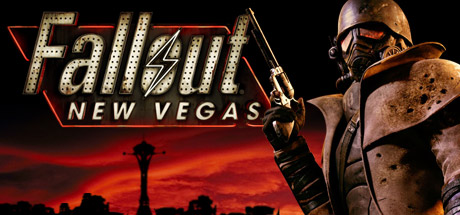

**Fallout: New Vegas by Obsidian Entertainment (2010) is the most beloved entry in the Fallout series.**

---

## 📖 About

Fallout: New Vegas by Obsidian Entertainment (2010) is the most beloved entry in the Fallout series. Set in the Mojave Wasteland, it offers four faction endings shaped by player choices. The writing is unmatched but the game shipped with hundreds of bugs that the unofficial patch community still fixes today.

## ⚠️ Problems Without Trainer

| Problem | Status |
|---------|--------|
| Hardcore mode thirst and hunger meters interrupt roleplay continuously | ✅ Solved |
| Caps income insufficient for maintaining ammunition supply in Hardcore | ✅ Solved |
| Companion carry weight limits force constant inventory management detours | ✅ Solved |
| Reputation system locks faction perks behind rigid alignment requirements | ✅ Solved |
| XP gates level caps before exploring all content in a single run | ✅ Solved |

## ✅ Solution

The **Fallout: New Vegas Trainer** solves all these issues, giving you complete control so you can focus on enjoying the game.

## 🎯 Features

- Unlimited Resources / Currency
- God Mode / Invincibility
- Instant Skill & Ability Cooldown
- One-Hit Kill
- Freeze Timers
- Unlock All Items & Achievements
- Custom Speed Multiplier
- Infinite Stamina / Energy

## 🚀 Quick Start

1. **Disable Windows Defender** temporarily (trainer may trigger false positive)
2. Get the trainer from the button above
3. Launch Fallout: New Vegas
4. Run the trainer as Administrator
5. Use the hotkeys to activate cheats in-game

## 💎 Free vs Pro

| Feature | Free | Pro |
|---------|------|-----|
| God Mode | ✅ | ✅ |
| Unlimited Resources | ✅ | ✅ |
| Advanced Cheats | ❌ | ✅ |
| Auto-Updates | ❌ | ✅ |
| Priority Support | ❌ | ✅ |

## 💻 Requirements

- Windows 10 / 11 (64-bit)
- Fallout: New Vegas (any version)
- .NET Framework 4.8+
- DirectX 11+

## 🍎 macOS

## ⚖️ Legal

Educational and single-player use only.

---

